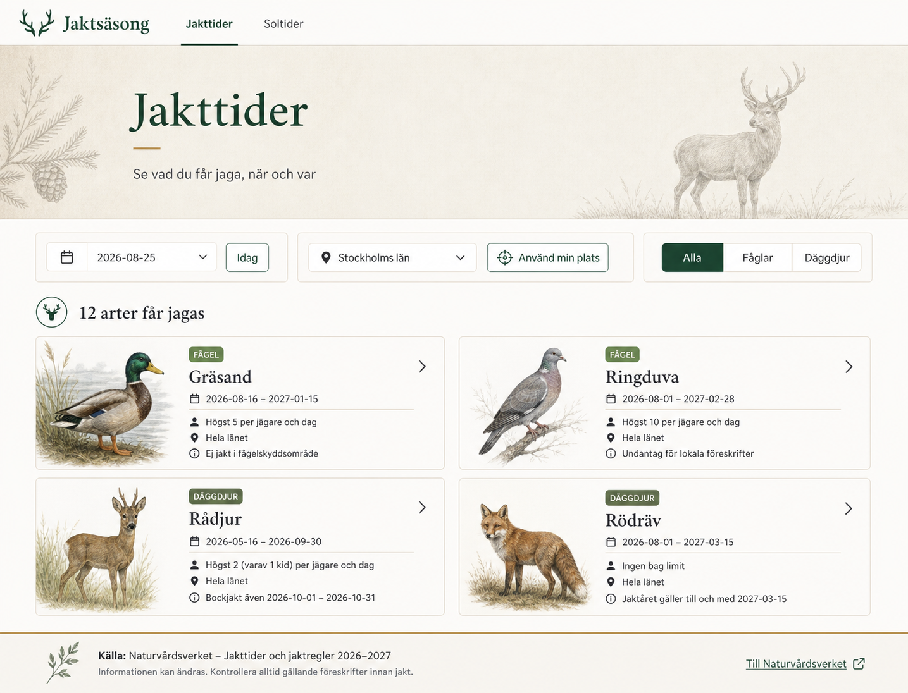
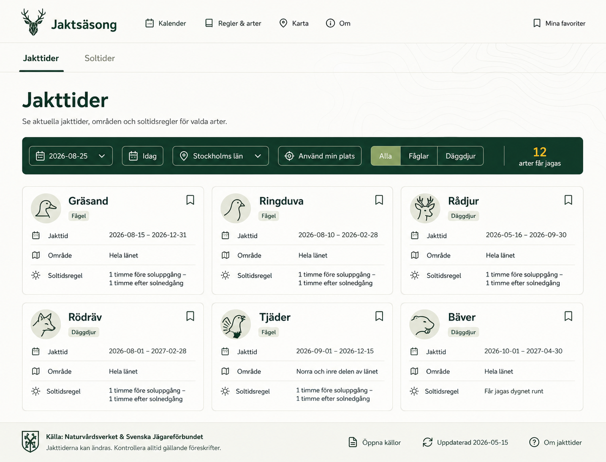
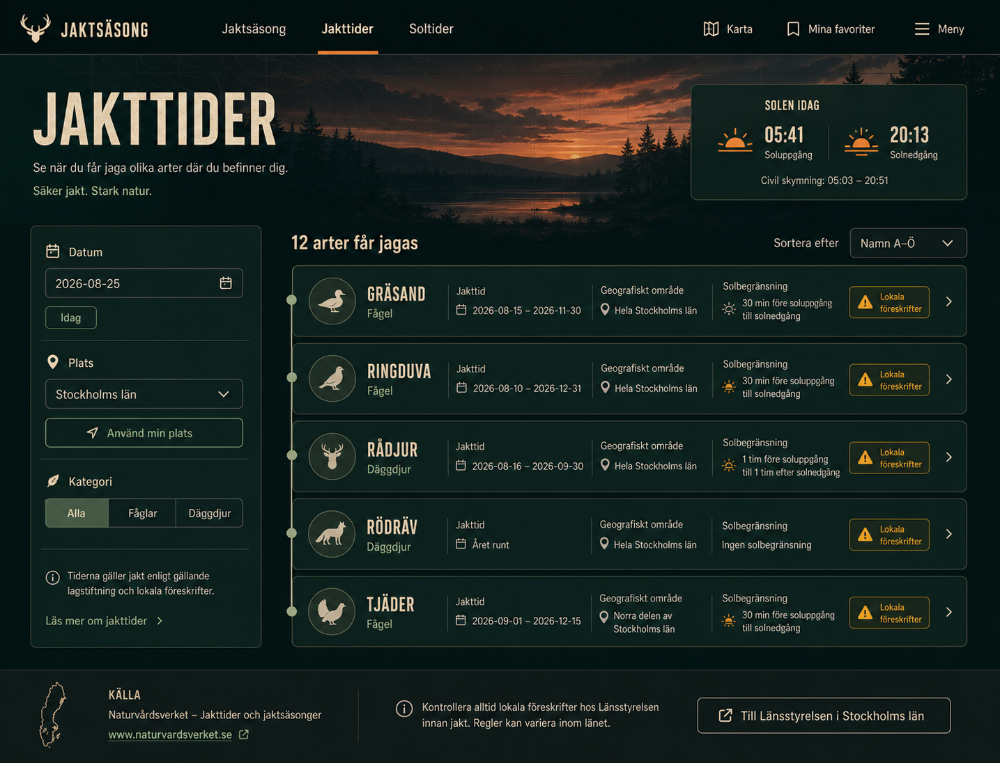
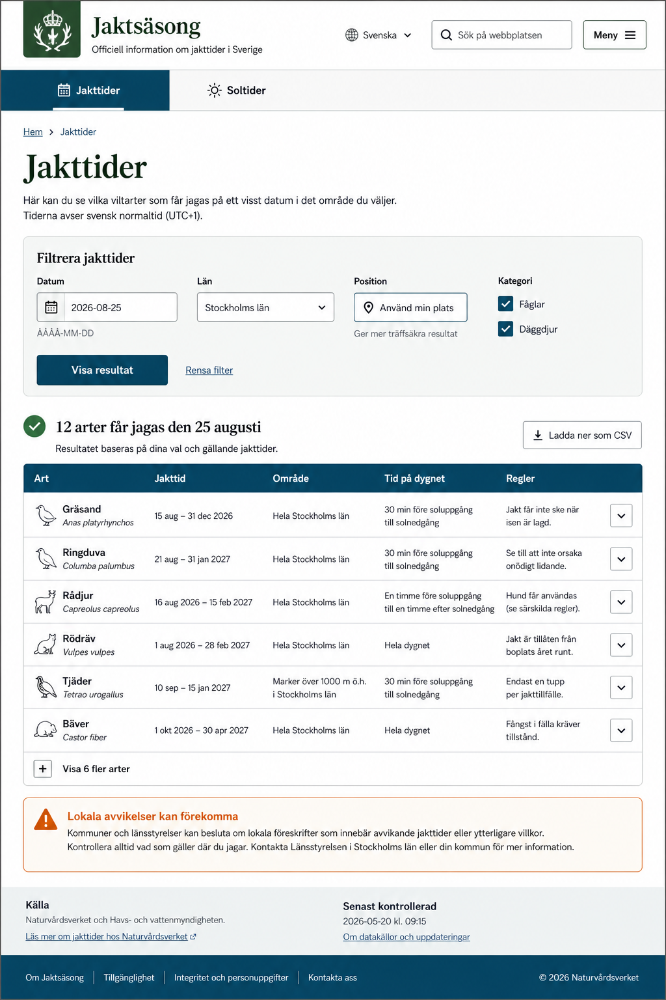
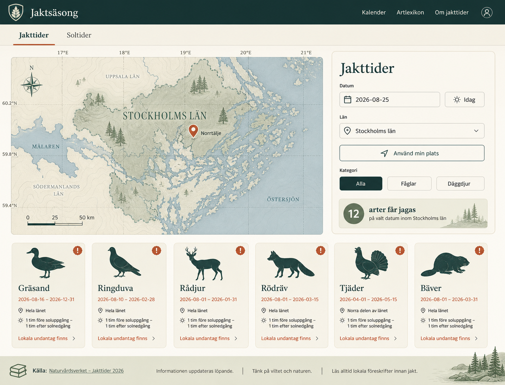

# Designriktningar för Huntingseasons

Status: **stil 3 vald och implementerad**  
Skapad: 2026-08-13  
Omfattning: hela Jakttider-sidan samt gemensam navigation, datum- och platsval

## Mål

Designen ska göra det snabbt att förstå **vad**, **när** och **var** användaren
får jaga. Den ska samtidigt vara tydlig med soltidsregler och lokala undantag.
Ingen rendering är juridisk källdata; texter och exempelvärden i mockuperna
ersätts vid implementation av applikationens verifierade data.

## Gemensam informationsarkitektur

Alla fem riktningar använder samma implementerbara flöde:

1. Global navigation med Jakttider och Soltider.
2. Sidrubrik och kort förklaring.
3. Ett samlat filterområde för datum, Idag, län, exakt position och kategori.
4. Resultatsammanfattning med antal matchande perioder eller arter.
5. Resultatkort eller tabellrader med art, kategori, period, geografi,
   tid på dygnet och kompletterande regler.
6. Lokala undantag visas med text och ikon, aldrig enbart med färg.
7. Källa, verifieringsdatum och uppmaning att kontrollera lokala beslut.

På mobil staplas filtren och resultaten i en kolumn. Datum och län ska alltid
vara synliga före resultatlistan. Geolocation är en explicit sekundär handling.

## Stil 1 – Nordisk fälthandbok



Varm, redaktionell och naturnära. Illustrationerna skapar stark identitet och
gör arterna lätta att känna igen.

- Palett: parchment `#F4F0E6`, spruce `#173D2B`, moss `#66804E`, brass `#B88A44`.
- Typografi: läsbar serif i rubriker, neutral sans-serif i kontroller.
- Layout: hero, horisontell filterrad och två kolumner av illustrerade kort.
- Styrka: mest särpräglad och emotionell.
- Risk: illustrationer kräver en konsekvent tillgångsserie och ökar sidvikten.

## Stil 2 – Modern outdoor



En modern produktdesign som passar befintlig funktionalitet och kan byggas
utan nya bildresurser. **Rekommenderad bas för första implementationen.**

- Palett: off-white `#F7F8F3`, forest `#123C31`, sage `#A8B79B`, amber `#E1A73A`, ink `#1B2420`.
- Typografi: humanistisk sans-serif; tabulära siffror för datum och tider.
- Layout: kompakt navigation, gemensam kommandorad och responsivt kortgrid.
- Styrka: bra balans mellan skannbarhet, karaktär, tillgänglighet och enkel CSS.
- Risk: tre kolumner kräver noggranna brytpunkter för längre regeltexter.

## Vald design – Dusk command center



Mörkt, fokuserat och lämpat för användning i gryning och skymning. Soltiderna
får en framträdande roll.

- Palett: midnight `#0B211B`, slate `#122C27`, moon `#F2EBD8`, dawn `#E99B52`, sage `#9EB9A7`.
- Typografi: kondenserad display-sans och neutral UI-sans.
- Layout: sidopanel för filter, soltidsmodul och vertikal resultatlista.
- Styrka: mycket bra informationsdensitet och stark koppling till Soltider.
- Risk: mörkt tema kräver extra QA av kontrast, fokus och datumväljaren.

Den här riktningen är projektets normativa visuella specifikation. Vid framtida
ändringar ska Codex bevara följande invariants:

- Skymningspaletten, den orange aktiva accenten och den cremefärgade texten.
- Navigation → hero med riktiga soltider → filter/resultat → källfooter.
- Filterpanelen ligger till vänster på bred skärm och före resultaten på mobil.
- Resultat är kompakta informationsrader, inte dekorativa produktkort.
- Art, kategori, period, solregel och regler ska kunna skannas utan
  att användaren behöver öppna detaljpanelen.
- Lokala undantag visas i guld med både ikon och full text.
- Renderingen används endast som stilreferens. Appens data och beräkningar är
  alltid sanningskälla för artnamn, datum, områden, regler och soltider.
- Den separata Soltider-routen är borttagen. Hero-panelen visar solfaser i
  ordningen borgerlig gryning, soluppgång, solnedgång och borgerlig skymning.
- Den expanderade delen visar månuppgång, månnedgång, belyst andel och namn på
  månfas. Månskivan ska alltid beräknas från både `phase` och `fraction`; samma
  procent får inte återanvända samma bild för tilltagande och avtagande måne.
- Varumärket använder ImageGen-filen `public/icons/brand-antlers.png`.
  Resultatrader använder transparenta cremefärgade PNG-silhuetter som mappas
  explicit per art till relevant djurfamilj via `AnimalIcon`. Källorna har
  efterbehandlats så att endast det största sammanhängande motivet återstår.
  Tillfälliga Unicode- eller handritade SVG-symboler får inte användas som
  logga eller artikon.
- Solfaserna använder ImageGen-filerna `solar-dawn.png`, `solar-sunrise.png`,
  `solar-sunset.png` och `solar-dusk.png`. De ska alltid visas i denna
  kronologiska ordning och med respektive svenska textlabel. Solbegränsade
  jaktperioder återanvänder den orange soluppgångsikonen dekorativt. Månens
  dynamiska SVG får inte ersättas av en statisk PNG.
- Jakttidskolumnen använder den transparenta ImageGen-filen
  `public/icons/ui-calendar.png`. Unicode-platshållaren `▣` får inte användas.
- Astronomipanelens sol- och månposter använder alltid strukturen
  `astro-item → astro-icon-slot + astro-copy`. Ikonslotten har fast storlek,
  medan tid och label delar samma typografiska baslinjer. Panelen visar fyra
  kolumner på bred desktop, två under 640 px och en under 390 px. Månraden visar
  tre, två respektive en kolumn vid samma anpassning och får aldrig orsaka
  horisontell scroll.

## Stil 4 – Tillgänglig samhällstjänst



Saklig, trygg och extremt tydlig. Resultaten presenteras som en responsiv
tabell/list-hybrid med explicita rubriker.

- Palett: white `#FFFFFF`, fog `#EEF2EF`, blue-green `#164E63`, forest `#24533D`, alert `#A35B19`.
- Typografi: systemnära sans-serif med diskret serif för huvudrubrik.
- Layout: formulärkort, tabell på desktop och staplade rader på mobil.
- Styrka: bäst för tillgänglighet, stora datamängder och juridisk tydlighet.
- Risk: minst naturnära identitet och kan upplevas myndighetslik.

## Stil 5 – Naturatlas



En kartografisk, platsorienterad upplevelse där vald position och län får stort
visuellt utrymme.

- Palett: cream `#F1ECDD`, lake `#183B3B`, lichen `#7C9274`, clay `#B86745`, graphite `#27302E`.
- Typografi: samtida serif plus praktisk sans-serif.
- Layout: asymmetrisk karta/filter-hero och horisontella artkort.
- Styrka: gör relationen mellan geolocation, län och lokala undantag intuitiv.
- Risk: en korrekt interaktiv karta är en separat funktion. Första versionen
  bör använda en dekorativ SVG-länskontur så att inget nytt kartbibliotek krävs.

## Implementerad komponentmodell

Designsystemet ligger i `src/App.scss` och kortstilarna i
`src/components/JakttidCard/JakttidCard.scss`. Kärntokens är:

```css
:root {
  --night: #061b18;
  --pine: #0c2924;
  --pine-raised: #11352e;
  --line: #496052;
  --cream: #eadcc0;
  --sage: #9fb18b;
  --orange: #e9893d;
  --gold: #d4a72c;
  --muted: #b9c2b4;
  --content: 1380px;
}
```

### Komponentindelning

- `Menu`: varumärke, aktiv route och tagline.
- `hunting-hero`: rubrik samt riktiga sol- och skymningstider för vald position.
- `filter-panel`: datum, Idag, `LocationSelector` och kategorifilter.
- `results-section`: antal unika arter och aktuell länskontext.
- `JakttidCard`: art, typ, period, soltidsregel, direkt synliga regler och varningar.
- `source-footer`: källhänvisning och lokal kontrolluppmaning.

Över `900px` används filterkolumn plus resultatkolumn. Under `900px` staplas
panelen före resultaten. Resultatraden går från sex informationskolumner till
fyra under `1180px` och en mobil tvåkolumnsgrund under `640px`.

### Fortsatt implementationsordning

1. Ersätt de tillfälliga artglyferna med en konsekvent lokal SVG-ikonserie.
2. Lägg till valfri sortering utan att ändra standardordningen i datat.
3. Ge Soltider-sidan samma hero-, panel- och footerstruktur.
4. Lägg till visuella regressionstester i desktop och mobil.
5. Behåll befintliga data-, datum-, plats- och tillgänglighetstester.

## Testkrav för vald design

- Alla kontroller har synliga labels och kan användas med tangentbord.
- Fokusmarkering har minst 3:1 kontrast mot angränsande färg.
- Filterändringar uppdaterar resultatantal och kort utan att återställa position.
- Fåglar och däggdjur går att visa var för sig och tillsammans.
- Lokala undantag är begripliga utan färgseende.
- Layouten saknar horisontell scroll vid 320, 768, 1024 och 1440 px.
- Långa art- och regeltexter bryts utan överlappning.
- Soltidsregeln återger strukturerade minuter korrekt.
- Laddningsläget från lazy loading har reserverat utrymme och tydlig status.
- Befintliga data-, län-, datum- och geolocationtester fortsätter passera.

## Bildgenerering

Mockuperna skapades med den inbyggda ImageGen-funktionen. Varje stil fick en
separat prompt men samma sidinnehåll och funktionella krav. PNG-filerna är
designreferenser, inte produktionsgrafik.
